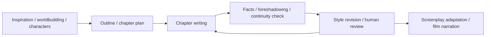

🌐 **English** · [简体中文](locales/zh/README.md) · [Español](locales/es/README.md) · [हिन्दी](locales/hi/README.md) · [Français](locales/fr/README.md)

# awesome_novel_writing

**A curated collection of AI novel-writing apps, long-form creation agents, writing skills, style-revision tools and screenplay-adaptation projects.**

Curated AI novel-writing apps, long-form fiction agents, writing skills, revision tools, and screenplay workflows — with evidence-linked descriptions and reproducible GitHub maintenance rankings.

Find tools by the actual creation workflow: from inspiration, settings and outlines to chapters, continuity checks, revision and adaptation. The focus is on projects whose implementation is inspectable on GitHub, while unverified licenses and additional license terms are labeled explicitly.

[Category index](#category-index) · [Project details](docs/projects.md) · [Ranking views](docs/rankings.md) · [Method](docs/methodology.md) · [Research log](docs/research.md) · [Contributing](CONTRIBUTING.md)



The diagram is a selection path; individual projects cover different scopes. The first release is a curated starting point and does not claim to list every project; stars and development activity do not equal the quality of finished fiction.

## Jump to a category

[Novel-writing software and workbenches](#novel-writing-software-and-workbenches) · [Automated writing agents and creation engines](#automated-writing-agents-and-creation-engines) · [Long-form creation skills and method frameworks](#long-form-creation-skills-and-method-frameworks) · [Style revision, de-templating and quality checks](#style-revision-de-templating-and-quality-checks) · [Screenplays, short-drama adaptation and film narration](#screenplays-short-drama-adaptation-and-film-narration) · [Creative writing evaluation tools](#creative-writing-evaluation-tools)

## Current coverage

**44 projects, covering all 14 deduplicated reference projects.** Feature review: 2026-11-26; metrics snapshot: `2026-11-26T09:58:02+00:00` (UTC).

Within each category, projects are grouped by maintenance tier first, then ranked by a blend of stars (40%), 90-day commit activity (35%) and the most recent default-branch commit (25%); archived projects come last. **The maintenance score does not measure novel quality, literary level, or one-click book-completion success.**

## Category index

`★` marks a user-provided reference project. Each entry has exactly one primary category; software, Skills, method frameworks and evaluation tools are compared separately. Feature descriptions come from public documentation; no third-party project was installed or executed.

| Category | Count | Top-ranked projects |
| --- | --- | --- |
| Novel-writing software and workbenches | 17 | Biz Novel Studio, Pagekin, StoryForge |
| Automated writing agents and creation engines | 6 | Openwrite, InkOS, novel-harness / Storyteller |
| Long-form creation skills and method frameworks | 7 | Oh Story, chinese-novelist, webnovel-writer-opencode |
| Style revision, de-templating and quality checks | 8 | avoid-ai-writing, Humanizer, Sepia |
| Screenplays, short-drama adaptation and film narration | 5 | drama-skills, shuohao-skills, juben / ai-juben |
| Creative writing evaluation tools | 1 | Longform Writing Bench |

### Novel-writing software and workbenches

| Project | Purpose | Form | Stars | 90-day commits | Last commit (UTC) | Maintenance score | License |
| --- | --- | --- | --- | --- | --- | --- | --- |
| [Biz Novel Studio](https://github.com/ExplosiveCoderflome/AI-Novel-Writing-Assistant) ★ · License caution | Organizes whole-novel production around worldbuilding, characters, chapter-by-chapter writing and checks. | Desktop / self-hosted workbench | 3,562 | 898 | 2026-11-25 | 88.1 | AGPL-3.0 + commercial addendum |
| [Pagekin](https://github.com/EthanYoQ/Pagekin) ★ | Long-form writing workbench covering settings, chapter blueprints, drafting, review and revision. | Desktop app | 2,913 | 5,208 | 2026-11-24 | 87.3 | GPL-3.0 |
| [StoryForge](https://github.com/yuanbw2025/storyforge) | Local-first storytelling tool covering novel creation, story adaptation and interactive experiences. | Creation workbench | 1,052 | 3,251 | 2026-11-25 | 83.9 | MIT |
| [NeuroBook](https://github.com/notnotype/neuro-book) | Organizes long-form writing with an editor, project files and extensible tools. | Creation IDE / preview | 800 | 8,471 | 2026-11-26 | 83.1 | AGPL-3.0 |
| [Denova](https://github.com/alfredxw/denova) ★ | Puts novels, interactive stories, a lore library and agent tools in one workspace. | Creation platform | 1,055 | 357 | 2026-11-24 | 81.8 | Apache-2.0 |
| [Reveric](https://github.com/looplj/reveric) ★ · License caution | Desktop creation workbench that connects long-form novels, screenplay adaptation, storyboarding, a 3D director's desk and editing through agents. | Local-first desktop creation workbench | 1,010 | 270 | 2026-11-25 | 80.4 | AGPL-3.0 + Section 7 attribution |
| [Goink](https://github.com/sigpanic/goink) | Writing system combining agent writing decisions, structured memory and post-writing state checks. | Desktop app | 550 | 416 | 2026-11-19 | 79.1 | AGPL-3.0 |
| [OpenFic](https://github.com/syrizelink/OpenFic) | Supports long-form co-creation with settings, characters and customizable Prompt/Agent workflows. | Cross-platform app | 1,321 | 109 | 2026-11-26 | 76.4 | Apache-2.0 |
| [Easy Writing](https://github.com/yilujian/easy-writing) ★ | Local chapter editing, word-count statistics, AI-assisted creation and work management. | Desktop app | 981 | 33 | 2026-11-03 | 63.2 | AGPL-3.0 |
| [Novel Studio](https://github.com/bbaz123/novel-studio) | Editor combined with story settings, character state, foreshadowing management and continuity checks. | Local web workbench | 9 | 194 | 2026-11-23 | 61.8 | MIT |
| [AI Novel Generator](https://github.com/YILING0013/AI_NovelGenerator) | Keeps characters, relationships, story plans and manuscripts in a project; candidate text is generated, then reviewed and saved by the author. | Local workbench | 6,546 | 5 | 2026-11-05 | 60.4 | AGPL-3.0 |
| [Vela](https://github.com/heider-x/vela) | Combines outlining, drafting, rewriting and review with a local RAG library. | Desktop IDE | 593 | 21 | 2026-10-19 | 56.0 | GPL-3.0 |
| [NovelClaw](https://github.com/iLearn-Lab/NovelClaw) | Organizes long-running creation with chapter drafts, inspectable runs, review and editable memory. | Self-hosted workbench | 375 | 3 | 2026-10-12 | 43.6 | MIT |
| [51mazi](https://github.com/xiaoshengxianjun/51mazi) | Novel editor and creation-assistance tool with AI writing and writing-material features. | Desktop app | 510 | 1 | 2026-08-31 | 35.1 | MIT |
| [QingZhu](https://github.com/FlickeringLamp/ai-novelist) | Explores AI text co-creation through tool calling and human-in-the-loop review. | Desktop creation tool | 227 | 0 | 2026-07-25 | 25.2 | MIT |
| [xnovelist](https://github.com/giapnguyen74/xnovelist) | Organizes manuscripts locally in the browser while you supply models for AI writing assistance. | Browser-local app | 13 | 0 | 2026-06-08 | 12.9 | MIT |
| [Agnes Creative OS](https://github.com/MXD706/agnes) · License caution | Novel workbench spanning worldbuilding, characters, plot, chapters, review and long-term memory. | Local workbench | 3 | 0 | 2026-05-27 | 8.1 | Unverified |

### Automated writing agents and creation engines

| Project | Purpose | Form | Stars | 90-day commits | Last commit (UTC) | Maintenance score | License |
| --- | --- | --- | --- | --- | --- | --- | --- |
| [Openwrite](https://github.com/LiPu-jpg/Openwrite) | Organizes novel creation, style processing and content review through AI workflows. | Creation engine | 1,023 | 218 | 2026-11-20 | 77.9 | Apache-2.0 |
| [InkOS](https://github.com/Narcooo/inkos) ★ | Creation-agent system supporting story planning, writing, review and revision. | Creation agent / workbench | 11,444 | 46 | 2026-10-24 | 71.4 | AGPL-3.0 |
| [novel-harness / Storyteller](https://github.com/Dankular/Storyteller) · License caution | Supports chaptered long-form writing with story settings, plot points, a foreshadowing ledger and continuity records. | Writing harness | 0 | 7 | 2026-09-12 | 22.6 | Unverified |
| [Novelist Agent](https://github.com/AxolDad/novelist) · License caution | Maintains characters, plot and voice across a long novel using database memory and multi-reviewer mechanisms. | Agent system / alpha | 2 | 0 | 2026-01-06 | 4.5 | Unverified |
| [Long-Novel-GPT](https://github.com/MaoXiaoYuZ/Long-Novel-GPT) · License caution | Organizes long-novel generation through layered expansion of outlines, chapters and text. | Long-form generator / agent | 1,260 | 0 | 2025-11-05 | 25.1 | Unverified |
| [Kimi Writing Agent](https://github.com/Doriandarko/kimi-writer) · License caution | Uses a model to plan, write, manage files and recover long-form work from context summaries. | CLI / agent | 596 | 0 | 2025-11-08 | 22.6 | MIT + commercial attribution clause |

### Long-form creation skills and method frameworks

| Project | Purpose | Form | Stars | 90-day commits | Last commit (UTC) | Maintenance score | License |
| --- | --- | --- | --- | --- | --- | --- | --- |
| [Oh Story](https://github.com/zenstory-ai/oh-story-claudecode) | Skill workflows covering web-novel research, teardown, long- and short-form writing and revision. | Agent skill pack | 8,958 | 160 | 2026-11-24 | 84.8 | MIT |
| [chinese-novelist](https://github.com/PenglongHuang/chinese-novelist-skill) ★ | Assists Chinese-language novel creation through Q&A, creation memory and chapter constraints. | Agent Skill | 5,592 | 57 | 2026-11-25 | 77.6 | MIT |
| [webnovel-writer-opencode](https://github.com/lujih/webnovel-writer-opencode) | Adapts the long-form web-novel workflow to OpenCode and adds writing-management features. | OpenCode port / extension | 228 | 205 | 2026-11-25 | 73.7 | GPL-3.0 |
| [webnovel-writer](https://github.com/lingfengQAQ/webnovel-writer) | Supports long serialized web-novel writing with layered planning, story state and retrieval. | Agent plugin / skill | 8,083 | 18 | 2026-11-19 | 71.0 | GPL-3.0 |
| [FuFu](https://github.com/usagifufu/FuFu-Novel-Writing) · License caution | Long-form writing flow organizing research, worldbuilding, outlines, foreshadowing, chapters and review. | WorkBuddy skill pack | 4 | 12 | 2026-10-19 | 36.4 | Unverified |
| [novel-writing-framework](https://github.com/LAY-lgtm/novel-writing-framework) ★ | Turns outlining, chapter-by-chapter writing, self-checks and platform adaptation into an engineered writing method. | Methodology / agent skill | 278 | 0 | 2026-05-31 | 23.0 | MIT |
| [long-novel-writer](https://github.com/jiaw-Zh/long-novel-writer) · License caution | Organizes long serialization around layered summaries and story-fact management. | Long-form writing Skill | 97 | 0 | 2026-05-15 | 18.8 | Unverified |

### Style revision, de-templating and quality checks

| Project | Purpose | Form | Stars | 90-day commits | Last commit (UTC) | Maintenance score | License |
| --- | --- | --- | --- | --- | --- | --- | --- |
| [avoid-ai-writing](https://github.com/conorbronsdon/avoid-ai-writing) ★ | Diagnoses and rewrites templated AI style, with detect-only and in-place edit modes. | Agent Skill / checker | 6,324 | 518 | 2026-11-24 | 90.0 | MIT |
| [Humanizer](https://github.com/blader/humanizer) | Checks and rewrites text against common AI writing features. | English polishing Skill | 73,753 | 70 | 2026-11-19 | 86.2 | MIT |
| [Sepia](https://github.com/Nanako0129/sepia) ★ | Repairs novel narrative structure before touching wording; rules for other genres apply by occasion. | Agent Skill | 3,958 | 379 | 2026-11-03 | 81.5 | MIT |
| [SimpleEnglish](https://github.com/AminBlg/SimpleEnglish) | An agent skill that makes LLMs write docs and replies in ASD-STE100 controlled English: short sentences, active voice, one meaning per word, plain by default and strict on request. | Controlled-English writing Skill | 4,672 | 56 | 2026-11-10 | 73.1 | MIT |
| [STE80 Humanizer](https://github.com/Dodaios/ste80-humanizer) | Two-pass rewrite: first strip the 26 AI tells from Wikipedia's Signs of AI writing list, then rebuild the sentences toward ASD-STE100 controlled English. | English rewrite Skill | 1,143 | 14 | 2026-11-24 | 64.2 | MIT |
| [Humanizer-zh](https://github.com/op7418/Humanizer-zh) | Identifies and revises mechanical, vague AI expression patterns using Chinese-language rules. | Chinese polishing Skill | 23,834 | 1 | 2026-09-23 | 51.1 | MIT |
| [qifeng-writing](https://github.com/Yuriloll/qifeng-writing) ★ | Diagnoses factual, structural, narrative and language issues in Chinese posts and articles. | Chinese-writing Skill | 40 | 2 | 2026-08-31 | 28.6 | MIT |
| [llmlint](https://github.com/notnotype/llmlint) | Scans writing traces with rules, providing locatable issues for revision. | Text rule linter | 13 | 0 | 2026-08-15 | 17.1 | AGPL-3.0 |

### Screenplays, short-drama adaptation and film narration

| Project | Purpose | Form | Stars | 90-day commits | Last commit (UTC) | Maintenance score | License |
| --- | --- | --- | --- | --- | --- | --- | --- |
| [drama-skills](https://github.com/zenstory-ai/drama-skills) | Organizes creation around short-drama story development, scripts, assets and storyboards. | Short-drama skill pack | 5,049 | 187 | 2026-11-24 | 83.6 | MIT |
| [shuohao-skills](https://github.com/eternityspring/shuohao-skills) ★ | Extends from novel-adapted outlines, characters and screenplays to scene direction and storyboard delivery. | Short-drama production skill pack | 7,161 | 54 | 2026-11-09 | 74.2 | Apache-2.0 |
| [juben / ai-juben](https://github.com/VanGong1999/juben) ★ | Assists film planning, screenplay creation and evaluation through professional agent workflows. | Screenplay agent platform | 193 | 7 | 2026-11-22 | 53.9 | MIT |
| [Narrator AI CLI Skill](https://github.com/NarratorAI-Studio/narrator-ai-cli-skill) ★ | Guides an agent to drive a CLI for film-narration production. | Companion CLI Skill | 3,324 | 0 | 2026-07-05 | 33.2 | MIT |
| [ai-short-drama](https://github.com/Hao0321/ai-short-drama) | Plot design and screenplay creation skills for AI short dramas. | Screenwriting Skill | 84 | 0 | 2026-08-13 | 23.2 | MIT |

### Creative writing evaluation tools

| Project | Purpose | Form | Stars | 90-day commits | Last commit (UTC) | Maintenance score | License |
| --- | --- | --- | --- | --- | --- | --- | --- |
| [Longform Writing Bench](https://github.com/EQ-bench/longform-writing-bench) · License caution | Evaluates model creative planning, revision and short-to-medium story generation. | Research / evaluation tool | 49 | 0 | 2025-10-26 | 13.9 | Unverified |

## How to choose

- Want to open a tool and start writing: look at the novel workbenches; compare editing and review experience, model configuration and backup options.
- Want chapter-by-chapter writing as a repeatable pipeline: look at the creation agents and long-form skills; check state, foreshadowing and revision mechanisms first.
- Already have a manuscript and need revision: look at revision tools such as Sepia and avoid-ai-writing; general article rules do not always fit fiction.
- Want to turn a novel into a short drama: look at the screenplay and adaptation category; film narration is not an original screenplay.

More specific boundaries and sources are in [project details](docs/projects.md); creation stages and categorization are in [scope and taxonomy](docs/taxonomy.md).

## Rankings, data and maintenance

- [Balanced / stars / activity / recent-commit rankings](docs/rankings.md)
- [Ranking formula and limitations](docs/methodology.md)
- [Search process, project renames and seed mapping](docs/research.md)
- [Projects JSON](data/projects.json) · [Metrics JSON](data/metrics.json) · [Rankings CSV](data/rankings.csv)
- [Contributing guide](CONTRIBUTING.md)

```sh
python scripts/refresh_metrics.py   # requires gh login or GH_TOKEN
python scripts/build.py
python -m unittest discover -s tests -v
python scripts/build.py --check
```

GitHub Actions refreshes the metrics and rankings of included repositories daily. New projects, categories, feature and license judgments are updated only after manual review. When API queries come back incomplete, the previous full snapshot is kept.

## Licenses and acknowledgements

Original curation and scripts in this catalogue use the [MIT](LICENSE) license; linked projects follow their own licenses. Public source code, open-source claims in READMEs and GitHub-detected licenses must be read together with each project's additional terms. Unverified licenses are never defaulted to MIT.

The ranking and update implementation follows [awesome_bot](https://github.com/ZanePoe/awesome_bot). Discovery leads referenced [Awesome Novel Tools](https://github.com/yutingzhao1991/awesome-novel-tools) and [Awesome Novel Skills](https://github.com/UnderleveledBuilder/awesome-novel-skills); final descriptions were verified against the original repositories.

[Change records](record/) keep the original text as written at verification time (Chinese), so the source and wording of every judgment stay auditable.
