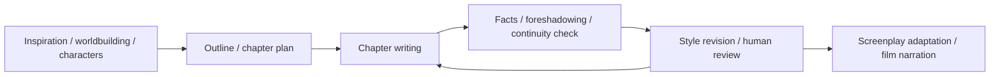

# awesome_novel_writing

**A curated collection of AI novel-writing apps, long-form creation agents, writing skills, style-revision tools and screenplay-adaptation projects.**

Curated AI novel-writing apps, long-form fiction agents, writing skills, revision tools, and screenplay workflows — with evidence-linked descriptions and reproducible GitHub maintenance rankings.

Find tools by the actual creation workflow: from inspiration, settings and outlines to chapters, continuity checks, revision and adaptation. The focus is on projects whose implementation is inspectable on GitHub, while unverified licenses and additional license terms are labeled explicitly.

[Category index](#category-index) · [Project details](docs/projects.md) · [Ranking views](docs/rankings.md) · [Method](docs/methodology.md) · [Research log](docs/research.md) · [Contributing](CONTRIBUTING.md)

The diagram is a selection path; individual projects cover different scopes. The first release is a curated starting point and does not claim to list every project; stars and development activity do not equal the quality of finished fiction.
