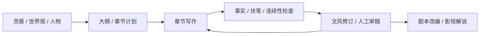

# awesome_novel_writing

**AI 小说写作、长篇创作 Agent、写作技能、文风修订与剧本改编项目合集。**

Curated AI novel-writing apps, long-form fiction agents, writing skills, revision tools, and screenplay workflows — with evidence-linked descriptions and reproducible GitHub maintenance rankings.

从灵感、设定与大纲，到章节、连续性检查、修订和改编，按实际创作环节寻找工具。收录重心是 GitHub 上可查看实现的项目，同时明确标注许可待核验与附加许可条件。

[分类目录](#分类目录) · [项目详表](docs/projects.md) · [排序视图](docs/rankings.md) · [方法](docs/methodology.md) · [检索记录](docs/research.md) · [贡献](CONTRIBUTING.md)

图示是选型路径，各项目的覆盖范围不同。首版为精选起点，不声称穷尽全部项目；star 和开发活动不等于作品质量。
