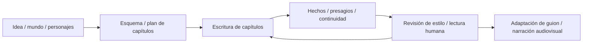

🌐 [English](../../README.md) · [简体中文](../zh/README.md) · **Español** · [हिन्दी](../hi/README.md) · [Français](../fr/README.md)

# awesome_novel_writing

**Colección de proyectos de escritura de novelas con IA, agentes de ficción larga, skills de escritura, revisión de estilo y adaptación de guiones.**

Curated AI novel-writing apps, long-form fiction agents, writing skills, revision tools, and screenplay workflows — with evidence-linked descriptions and reproducible GitHub maintenance rankings.

Desde la idea, la ambientación y el esquema hasta los capítulos, la comprobación de continuidad, la revisión y la adaptación: busca la herramienta según la fase real de creación. El foco de la selección son proyectos cuya implementación puede revisarse en GitHub, y se señalan expresamente las licencias pendientes de verificación y las condiciones adicionales.

[Categorías](#categorías) · [Tabla de proyectos](docs/projects.md) · [Vistas de ranking](docs/rankings.md) · [Metodología](docs/methodology.md) · [Registro de búsqueda](docs/research.md) · [Contribuir](CONTRIBUTING.md)



El diagrama traza una ruta de selección; cada proyecto cubre un alcance distinto. La primera versión es un punto de partida curado y no afirma agotar todos los proyectos; las estrellas y la actividad de desarrollo no equivalen a la calidad de las obras.

## Ir a una categoría

[Aplicaciones de escritura de novelas y entornos de creación](#aplicaciones-de-escritura-de-novelas-y-entornos-de-creación) · [Agentes de escritura automática y motores de creación](#agentes-de-escritura-automática-y-motores-de-creación) · [Skills y marcos de método para novela larga](#skills-y-marcos-de-método-para-novela-larga) · [Revisión de estilo, desplantillado y control de calidad](#revisión-de-estilo-desplantillado-y-control-de-calidad) · [Guiones, adaptación de drama corto y narración audiovisual](#guiones-adaptación-de-drama-corto-y-narración-audiovisual) · [Herramientas de evaluación de escritura creativa](#herramientas-de-evaluación-de-escritura-creativa)

## Inclusiones actuales

**42 proyectos, que cubren los 14 proyectos de referencia deduplicados.** Verificación funcional: 2026-11-06; instantánea de métricas: `2026-11-25T11:13:03+00:00` (UTC).

Dentro de cada categoría se agrupa primero por estado de mantenimiento y luego se ordena combinando estrellas (40%), actividad de commits a 90 días (35%) y último commit de la rama predeterminada (25%). Los proyectos archivados van al final. **La puntuación de mantenimiento no mide la calidad de la novela, el nivel literario ni la tasa de éxito de generar un libro completo con un clic.**

## Categorías

`★` marca los proyectos de referencia aportados por el usuario. Cada entrada tiene una sola categoría principal; software, skills, marcos de método y herramientas de evaluación se comparan por separado. Las descripciones de funciones provienen de la documentación pública; no se instaló ni ejecutó ningún proyecto de terceros.

| Categoría | Cantidad | Proyectos mejor posicionados |
| --- | --- | --- |
| Aplicaciones de escritura de novelas y entornos de creación | 17 | Biz Novel Studio, Shutong Pagekin, StoryForge |
| Agentes de escritura automática y motores de creación | 6 | Openwrite, InkOS, novel-harness / Storyteller |
| Skills y marcos de método para novela larga | 7 | Oh Story, chinese-novelist, webnovel-writer |
| Revisión de estilo, desplantillado y control de calidad | 6 | avoid-ai-writing, Humanizer, Sepia |
| Guiones, adaptación de drama corto y narración audiovisual | 5 | drama-skills, shuohao-skills, juben / ai-juben |
| Herramientas de evaluación de escritura creativa | 1 | Longform Writing Bench |

### Aplicaciones de escritura de novelas y entornos de creación

| Proyecto | Para qué sirve | Forma | Stars | Commits 90 días | Último commit UTC | Puntuación de mantenimiento | Licencia |
| --- | --- | --- | --- | --- | --- | --- | --- |
| [Biz Novel Studio](https://github.com/ExplosiveCoderflome/AI-Novel-Writing-Assistant) ★ · Atención de licencia | Organiza la producción de una novela completa alrededor del mundo, los personajes, la escritura capítulo a capítulo y la comprobación. | Escritorio / entorno autoalojado | 3,558 | 901 | 2026-11-25 | 88.4 | AGPL-3.0 + condiciones comerciales adicionales |
| [Shutong Pagekin](https://github.com/EthanYoQ/Pagekin) ★ | Entorno de creación para novela larga que va de la ambientación y el plan de capítulos al texto, la lectura crítica y la revisión. | Aplicación de escritorio | 2,873 | 5,208 | 2026-11-24 | 87.5 | GPL-3.0 |
| [StoryForge](https://github.com/yuanbw2025/storyforge) | Herramienta de narración local-first que abarca la creación de novelas, la adaptación de historias y la experiencia interactiva. | Entorno de creación | 1,050 | 3,244 | 2026-11-25 | 84.2 | MIT |
| [NeuroBook](https://github.com/notnotype/neuro-book) | Organiza la escritura de novela larga con editor, archivo de proyecto y herramientas extensibles. | IDE de creación / versión previa | 798 | 8,151 | 2026-11-25 | 83.1 | AGPL-3.0 |
| [Denova](https://github.com/alfredxw/denova) ★ | Reúne en un mismo espacio de trabajo novelas, historias interactivas, bases de referencia y herramientas de agente. | Plataforma de creación | 1,054 | 360 | 2026-11-24 | 82.1 | Apache-2.0 |
| [Reveric](https://github.com/looplj/reveric) ★ · Atención de licencia | Entorno de creación de escritorio que enlaza novela larga, adaptación de guion, guion gráfico, mesa de dirección 3D y edición mediante agentes. | Entorno de creación de escritorio local-first | 999 | 260 | 2026-11-24 | 80.0 | AGPL-3.0 + requisito de atribución de la Sección 7 |
| [Goink](https://github.com/sigpanic/goink) | Sistema de escritura que une decisiones de redacción del agente, memoria estructurada y comprobación de estado después de escribir. | Aplicación de escritorio | 550 | 416 | 2026-11-19 | 79.3 | AGPL-3.0 |
| [OpenFic](https://github.com/syrizelink/OpenFic) | Coficción de novela larga mediante ambientación, personajes y flujos de prompts / agentes personalizables. | Aplicación multiplataforma | 1,317 | 111 | 2026-11-25 | 76.5 | Apache-2.0 |
| [Yichuang easy-writing](https://github.com/yilujian/easy-writing) ★ | Edición local de capítulos, estadísticas de escritura, asistencia de creación con IA y gestión de obras. | Aplicación de escritorio | 978 | 33 | 2026-11-03 | 63.4 | AGPL-3.0 |
| [Novel Studio](https://github.com/bbaz123/novel-studio) | Editor combinado con ambientación de la historia, estado de personajes, gestión de presagios y control de continuidad. | Entorno web local | 8 | 194 | 2026-11-23 | 61.7 | MIT |
| [AI Novel Generator](https://github.com/YILING0013/AI_NovelGenerator) | Mantiene personajes, relaciones, plan argumental y prosa dentro del proyecto; genera candidatos que una persona revisa antes de guardar. | Entorno local | 6,540 | 5 | 2026-11-05 | 60.6 | AGPL-3.0 |
| [Vela](https://github.com/heider-x/vela) | Combina esquema, primer borrador, reescritura y revisión con una base de referencia local mediante RAG. | IDE de escritorio | 593 | 21 | 2026-10-19 | 56.2 | GPL-3.0 |
| [NovelClaw](https://github.com/iLearn-Lab/NovelClaw) | Organiza la creación de larga duración con borradores por capítulo, ejecuciones inspeccionables, revisión crítica y memoria editable. | Entorno autoalojado | 375 | 3 | 2026-10-12 | 43.7 | MIT |
| [51mazi](https://github.com/xiaoshengxianjun/51mazi) | Editor de novelas y asistente de creación con escritura por IA y recursos de material creativo. | Aplicación de escritorio | 509 | 1 | 2026-08-31 | 35.2 | MIT |
| [Qingzhu ai-novelist](https://github.com/FlickeringLamp/ai-novelist) | Explora la coescritura de texto con IA mediante llamadas a herramientas y intervención humana en el bucle. | Herramienta de creación de escritorio | 227 | 0 | 2026-07-25 | 25.2 | MIT |
| [xnovelist](https://github.com/giapnguyen74/xnovelist) | Organiza el manuscrito en local dentro del navegador, con asistencia de escritura por IA usando el modelo que elijas. | Aplicación local en el navegador | 13 | 0 | 2026-06-08 | 13.0 | MIT |
| [Agnes Creative OS](https://github.com/MXD706/agnes) · Atención de licencia | Entorno de novelas que cubre mundo, personajes, trama, capítulos, revisión y memoria de larga duración. | Entorno local | 3 | 0 | 2026-05-27 | 8.1 | Pendiente de verificación |

### Agentes de escritura automática y motores de creación

| Proyecto | Para qué sirve | Forma | Stars | Commits 90 días | Último commit UTC | Puntuación de mantenimiento | Licencia |
| --- | --- | --- | --- | --- | --- | --- | --- |
| [Openwrite](https://github.com/LiPu-jpg/Openwrite) | Organiza la creación de novelas, el tratamiento del estilo y la revisión de contenido mediante flujos de IA. | Motor de creación | 1,022 | 218 | 2026-11-20 | 78.1 | Apache-2.0 |
| [InkOS](https://github.com/Narcooo/inkos) ★ | Sistema de agente creativo que admite planificar la historia, escribir, revisar críticamente y reescribir. | Agente de creación / entorno | 11,428 | 48 | 2026-10-24 | 71.8 | AGPL-3.0 |
| [novel-harness / Storyteller](https://github.com/Dankular/Storyteller) · Atención de licencia | Apoya la escritura por capítulos de novela larga con ambientación, puntos de trama, registro de presagios y bitácora de continuidad. | Harness de escritura | 0 | 7 | 2026-09-12 | 22.7 | Pendiente de verificación |
| [Novelist Agent](https://github.com/AxolDad/novelist) · Atención de licencia | Mantiene personajes, trama y tono de una novela larga con memoria en base de datos y múltiples mecanismos de revisión. | Sistema de agentes / alfa | 2 | 0 | 2026-01-06 | 4.5 | Pendiente de verificación |
| [Long-Novel-GPT](https://github.com/MaoXiaoYuZ/Long-Novel-GPT) · Atención de licencia | Estructura la generación de novela larga por expansión escalonada: esquema, capítulos y prosa. | Generador de novela larga / agente | 1,259 | 0 | 2025-11-05 | 25.1 | Pendiente de verificación |
| [Kimi Writing Agent](https://github.com/Doriandarko/kimi-writer) · Atención de licencia | Usa un modelo para planificar, escribir, gestionar archivos y reanudar la novela larga desde resúmenes de contexto. | CLI / agente | 596 | 0 | 2025-11-08 | 22.6 | MIT + cláusula de atribución comercial |

### Skills y marcos de método para novela larga

| Proyecto | Para qué sirve | Forma | Stars | Commits 90 días | Último commit UTC | Puntuación de mantenimiento | Licencia |
| --- | --- | --- | --- | --- | --- | --- | --- |
| [Oh Story](https://github.com/zenstory-ai/oh-story-claudecode) | Flujo de skills que cubre el estudio de la web-novela, el análisis de obras, la escritura larga y corta y la revisión. | Paquete de skills para agente | 8,918 | 163 | 2026-11-24 | 85.1 | MIT |
| [chinese-novelist](https://github.com/PenglongHuang/chinese-novelist-skill) ★ | Asiste la creación de novelas en chino con preguntas guiadas, memoria de creación y restricciones por capítulo. | Skill de agente | 5,567 | 53 | 2026-11-24 | 77.2 | MIT |
| [webnovel-writer](https://github.com/lingfengQAQ/webnovel-writer) | Apoya la serialización de web-novels con planificación por capas, estado de la historia y recuperación de contexto. | Complemento / skill de agente | 8,067 | 18 | 2026-11-19 | 71.2 | GPL-3.0 |
| [webnovel-writer-opencode](https://github.com/lujih/webnovel-writer-opencode) | Adapta el flujo de web-novela larga a OpenCode y añade capacidades de gestión de la escritura. | Puerto / extensión de OpenCode | 228 | 190 | 2026-11-01 | 67.6 | GPL-3.0 |
| [FuFu Novel Writing Assistant](https://github.com/usagifufu/FuFu-Novel-Writing) · Atención de licencia | Proceso de novela larga que organiza investigación, mundo, esquema, presagios, capítulos y corrección. | Paquete de skills WorkBuddy | 4 | 12 | 2026-10-19 | 36.6 | Pendiente de verificación |
| [novel-writing-framework](https://github.com/LAY-lgtm/novel-writing-framework) ★ | Convierte esquema, escritura capítulo a capítulo, autochequeo y adaptación a plataformas en un método de escritura sistematizado. | Metodología / skill de agente | 276 | 0 | 2026-05-31 | 23.0 | MIT |
| [long-novel-writer](https://github.com/jiaw-Zh/long-novel-writer) · Atención de licencia | Gestiona seriales de larga duración en torno a resúmenes por capas y un registro de hechos de la historia. | Skill de novela larga | 96 | 0 | 2026-05-15 | 18.8 | Pendiente de verificación |

### Revisión de estilo, desplantillado y control de calidad

| Proyecto | Para qué sirve | Forma | Stars | Commits 90 días | Último commit UTC | Puntuación de mantenimiento | Licencia |
| --- | --- | --- | --- | --- | --- | --- | --- |
| [avoid-ai-writing](https://github.com/conorbronsdon/avoid-ai-writing) ★ | Diagnostica y reescribe el estilo de IA plantificado, con modos de solo detección y de edición en el sitio. | Skill de agente / verificador | 6,290 | 518 | 2026-11-24 | 90.3 | MIT |
| [Humanizer](https://github.com/blader/humanizer) | Revisa y reescribe texto a partir de los rasgos frecuentes de la escritura de IA. | Skill de pulido en inglés | 73,402 | 70 | 2026-11-19 | 86.4 | MIT |
| [Sepia](https://github.com/Nanako0129/sepia) ★ | Repara primero la estructura narrativa de la novela y luego pasa a la frase; otras tipologías aplican reglas según el contexto. | Skill de agente | 3,954 | 389 | 2026-11-03 | 81.9 | MIT |
| [Humanizer-zh](https://github.com/op7418/Humanizer-zh) | Detecta y corrige, con reglas adaptadas al chino, las expresiones mecánicas y vagas típicas de la IA. | Skill de pulido en chino | 23,758 | 1 | 2026-09-23 | 51.3 | MIT |
| [qifeng-writing](https://github.com/Yuriloll/qifeng-writing) ★ | Diagnostica hechos, estructura, narración y lenguaje de hilos y artículos en chino. | Skill de escritura en chino | 40 | 2 | 2026-08-31 | 28.7 | MIT |
| [llmlint](https://github.com/notnotype/llmlint) | Escanea rastros de escritura con reglas y ofrece problemas localizables para la revisión. | Verificador de reglas de texto | 13 | 0 | 2026-08-15 | 17.2 | AGPL-3.0 |

### Guiones, adaptación de drama corto y narración audiovisual

| Proyecto | Para qué sirve | Forma | Stars | Commits 90 días | Último commit UTC | Puntuación de mantenimiento | Licencia |
| --- | --- | --- | --- | --- | --- | --- | --- |
| [drama-skills](https://github.com/zenstory-ai/drama-skills) | Organiza el desarrollo de historias de drama corto, libretos, assets y guiones gráficos. | Paquete de skills de drama corto | 4,990 | 189 | 2026-11-24 | 83.9 | MIT |
| [shuohao-skills](https://github.com/eternityspring/shuohao-skills) ★ | Lleva desde la adaptación de la novela —escaleta, personajes, libreto— hasta la planificación de escenas y la entrega de guiones gráficos. | Paquete de skills de producción de drama corto | 7,117 | 54 | 2026-11-09 | 74.3 | Apache-2.0 |
| [juben / ai-juben](https://github.com/VanGong1999/juben) ★ | Asiste la planificación audiovisual, la escritura de guiones y su evaluación mediante un flujo de agentes profesionales. | Plataforma de agentes de guion | 193 | 7 | 2026-11-22 | 54.1 | MIT |
| [Narrator AI CLI Skill](https://github.com/NarratorAI-Studio/narrator-ai-cli-skill) ★ | Guía a un agente para usar la CLI y producir vídeos de comentario audiovisual. | Skill complementaria de CLI | 3,324 | 0 | 2026-07-05 | 33.3 | MIT |
| [ai-short-drama](https://github.com/Hao0321/ai-short-drama) | Skills de diseño argumental y escritura de libretos para drama corto con IA. | Skill de guionista | 84 | 0 | 2026-08-13 | 23.3 | MIT |

### Herramientas de evaluación de escritura creativa

| Proyecto | Para qué sirve | Forma | Stars | Commits 90 días | Último commit UTC | Puntuación de mantenimiento | Licencia |
| --- | --- | --- | --- | --- | --- | --- | --- |
| [Longform Writing Bench](https://github.com/EQ-bench/longform-writing-bench) · Atención de licencia | Evalúa la planificación creativa, la revisión y la generación de relatos de extensión corta y media por parte de los modelos. | Investigación / herramienta de evaluación | 49 | 0 | 2025-10-26 | 13.9 | Pendiente de verificación |

## Cómo elegir

- Si quieres abrir un programa y ponerte a escribir: mira los entornos de creación de novelas y compara la experiencia de edición y revisión, la configuración de modelos y las formas de copia de seguridad.
- Si quieres convertir la escritura por capítulos en un flujo repetible: mira los agentes de creación y las skills de novela larga; revisa primero el estado de la historia, los presagios y los mecanismos de revisión.
- Si ya tienes el texto y necesitas reescribirlo: mira las herramientas de revisión como Sepia y avoid-ai-writing; las reglas para artículos generales no siempre valen para ficción.
- Si quieres adaptar una novela a drama corto: mira la categoría de guiones y adaptación; la narración audiovisual no equivale a un guion original.

Las fronteras y fuentes más detalladas están en [la tabla de proyectos](docs/projects.md); las fases de creación y las categorías, en [el criterio de clasificación](docs/taxonomy.md).

## Rankings, datos y mantenimiento

- [Vistas combinada / Estrellas / Actividad / Último commit](docs/rankings.md)
- [Fórmula de ranking y sus limitaciones](docs/methodology.md)
- [Proceso de búsqueda, cambios de nombre y mapeo de semillas](docs/research.md)
- [JSON de datos](../../data/projects.json) · [JSON de métricas](../../data/metrics.json) · [CSV del ranking](../../data/rankings.csv)
- [Guía de contribución](CONTRIBUTING.md)

```sh
python scripts/refresh_metrics.py   # requiere sesión de gh o GH_TOKEN
python scripts/build.py
python -m unittest discover -s tests -v
python scripts/build.py --check
```

GitHub Actions refresca a diario las métricas y el ranking de los repositorios incluidos. Los nuevos proyectos, categorías, funciones y juicios de licencia se actualizan tras verificación manual. Si una consulta a la API queda incompleta, se conserva la última instantánea completa.

## Licencias y agradecimientos

La recopilación original y los scripts de este catálogo están bajo [MIT](../../LICENSE); los proyectos enlazados se rigen por sus propias licencias. El código público, la afirmación de código abierto del README y la licencia que detecta GitHub deben leerse junto con las notas adicionales de cada proyecto. Una licencia sin verificar no se registra por defecto como MIT.

La implementación del ranking y de las actualizaciones sigue el patrón de [awesome_bot](https://github.com/ZanePoe/awesome_bot). Las pistas de descubrimiento tomaron como referencia [Awesome Novel Tools](https://github.com/yutingzhao1991/awesome-novel-tools) y [Awesome Novel Skills](https://github.com/UnderleveledBuilder/awesome-novel-skills); las descripciones finales se verificaron contra los repositorios originales.

[Registro de cambios](../../record/) conserva el texto original (en chino) vigente en el momento de cada revisión, para auditar el origen y la formulación de cada decisión.
