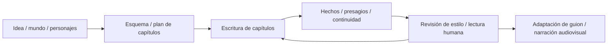

# awesome_novel_writing

**Colección de proyectos de escritura de novelas con IA, agentes de ficción larga, skills de escritura, revisión de estilo y adaptación de guiones.**

Curated AI novel-writing apps, long-form fiction agents, writing skills, revision tools, and screenplay workflows — with evidence-linked descriptions and reproducible GitHub maintenance rankings.

Desde la idea, la ambientación y el esquema hasta los capítulos, la comprobación de continuidad, la revisión y la adaptación: busca la herramienta según la fase real de creación. El foco de la selección son proyectos cuya implementación puede revisarse en GitHub, y se señalan expresamente las licencias pendientes de verificación y las condiciones adicionales.

[Categorías](#categorías) · [Tabla de proyectos](docs/projects.md) · [Vistas de ranking](docs/rankings.md) · [Metodología](docs/methodology.md) · [Registro de búsqueda](docs/research.md) · [Contribuir](CONTRIBUTING.md)

El diagrama traza una ruta de selección; cada proyecto cubre un alcance distinto. La primera versión es un punto de partida curado y no afirma agotar todos los proyectos; las estrellas y la actividad de desarrollo no equivalen a la calidad de las obras.
