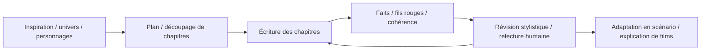

🌐 [English](../../README.md) · [简体中文](../zh/README.md) · [Español](../es/README.md) · [हिन्दी](../hi/README.md) · **Français**

# awesome_novel_writing

**Collection d'applications d'écriture de romans par IA, d'agents de création long format, de Skills d'écriture, d'outils de révision stylistique et de workflows d'adaptation de scénarios.**

Sélection de projets d'écriture de romans par IA, de fiction long format agentique, de Skills d'écriture, d'outils de révision et de workflows de scénarisation — avec des descriptions liées à des preuves et des classements de maintenance GitHub reproductibles.

De l'inspiration, de la bible et du plan jusqu'aux chapitres, aux contrôles de cohérence, à la révision et à l'adaptation, cherchez l'outil selon l'étape réelle de création. Le catalogue privilégie les projets dont l'implémentation est consultable sur GitHub, en signalant explicitement les licences à vérifier et les conditions de licence supplémentaires.

[Index par catégorie](#index-par-catégorie) · [Détail des projets](docs/projects.md) · [Vues de classement](docs/rankings.md) · [Méthode](docs/methodology.md) · [Journal de recherche](docs/research.md) · [Contribuer](CONTRIBUTING.md)



Le diagramme est un chemin de choix ; les projets ne couvrent pas tous les mêmes périmètres. La première version est un point de départ sélectif et ne prétend pas recenser tous les projets ; les étoiles et l'activité de développement ne disent rien de la qualité des œuvres.

## Aller à une catégorie

[Logiciels et ateliers d'écriture de romans](#logiciels-et-ateliers-décriture-de-romans) · [Agents d'écriture automatisés et moteurs de création](#agents-décriture-automatisés-et-moteurs-de-création) · [Skills et cadres méthodologiques pour le long format](#skills-et-cadres-méthodologiques-pour-le-long-format) · [Révision stylistique, détemplatisation et contrôle qualité](#révision-stylistique-détemplatisation-et-contrôle-qualité) · [Scénarios, adaptation en mini-drames et explications de films](#scénarios-adaptation-en-mini-drames-et-explications-de-films) · [Outils d'évaluation de l'écriture créative](#outils-dévaluation-de-lécriture-créative)

## Sélection actuelle

**44 projets, couvrant la totalité des 14 projets de référence dédupliqués.** Vérification fonctionnelle : 2026-11-26 ; instantané des métriques : `2026-11-28T09:20:44+00:00` (UTC).

Dans chaque catégorie, les projets sont d'abord stratifiés par état de maintenance, puis classés en combinant étoiles (40 %), commits sur 90 jours (35 %) et récence du dernier commit de la branche par défaut (25 %). Les projets archivés sont relégués en fin de liste. **Le score de maintenance ne représente ni la qualité d'un roman, ni son niveau littéraire, ni un taux de réussite de génération automatique de livres entiers.**

## Index par catégorie

`★` signale un projet de référence fourni par l'utilisateur. Chaque entrée n'a qu'une seule catégorie principale ; logiciels, Skills, cadres méthodologiques et outils d'évaluation sont comparés séparément. Les descriptions des fonctionnalités proviennent de la documentation publique ; les projets tiers n'ont pas été installés ni exécutés.

| Catégorie | Nombre | Projets les mieux classés |
| --- | --- | --- |
| Logiciels et ateliers d'écriture de romans | 17 | Biz Novel Studio, Pagekin, StoryForge |
| Agents d'écriture automatisés et moteurs de création | 6 | Openwrite, InkOS, novel-harness / Storyteller |
| Skills et cadres méthodologiques pour le long format | 7 | Oh Story, chinese-novelist, webnovel-writer-opencode |
| Révision stylistique, détemplatisation et contrôle qualité | 8 | avoid-ai-writing, Humanizer, Sepia |
| Scénarios, adaptation en mini-drames et explications de films | 5 | drama-skills, shuohao-skills, juben / ai-juben |
| Outils d'évaluation de l'écriture créative | 1 | Longform Writing Bench |

### Logiciels et ateliers d'écriture de romans

| Projet | Usage | Forme | Étoiles | Commits 90 j | Dernier commit UTC | Score de maintenance | Licence |
| --- | --- | --- | --- | --- | --- | --- | --- |
| [Biz Novel Studio](https://github.com/ExplosiveCoderflome/AI-Novel-Writing-Assistant) ★ · Attention licence | Organise la production d'un roman entier autour de l'univers, des personnages, de l'écriture chapitre par chapitre et des contrôles. | Atelier desktop / auto-hébergé | 3,580 | 929 | 2026-11-28 | 88.4 | AGPL-3.0 + conditions commerciales supplémentaires |
| [Pagekin](https://github.com/EthanYoQ/Pagekin) ★ | Atelier d'écriture long format, de la bible et du découpage de chapitres jusqu'au texte, à la relecture et à la révision. | Application de bureau | 2,947 | 5,503 | 2026-11-28 | 87.8 | GPL-3.0 |
| [StoryForge](https://github.com/yuanbw2025/storyforge) | Outil narratif local-first couvrant l'écriture de romans, l'adaptation de récits et les expériences interactives. | Atelier de création | 1,053 | 3,601 | 2026-11-28 | 84.2 | MIT |
| [NeuroBook](https://github.com/notnotype/neuro-book) | Organise l'écriture long format avec éditeur, fichiers de projet et outils extensibles. | IDE de création / version d'aperçu | 806 | 9,385 | 2026-11-27 | 83.1 | AGPL-3.0 |
| [Denova](https://github.com/alfredxw/denova) ★ | Réunit romans, histoires interactives, bases documentaires et outils d'agents dans un même espace de travail. | Plateforme de création | 1,058 | 347 | 2026-11-28 | 82.1 | Apache-2.0 |
| [Reveric](https://github.com/looplj/reveric) ★ · Attention licence | Atelier de création desktop reliant longs romans, adaptation de scénarios, storyboard, table de réalisation 3D et montage via des agents. | Atelier de création desktop local-first | 1,069 | 278 | 2026-11-27 | 80.8 | AGPL-3.0 + exigence d'attribution Section 7 |
| [Goink](https://github.com/sigpanic/goink) | Système d'écriture combinant décisions d'écriture par agent, mémoire structurée et vérifications d'état après rédaction. | Application de bureau | 554 | 416 | 2026-11-19 | 78.6 | AGPL-3.0 |
| [OpenFic](https://github.com/syrizelink/OpenFic) | Co-création long format appuyée sur la bible, les personnages et des workflows Prompt / Agent personnalisables. | Application multiplateforme | 1,323 | 109 | 2026-11-28 | 76.4 | Apache-2.0 |
| [easy-writing](https://github.com/yilujian/easy-writing) ★ | Édition locale des chapitres, statistiques de frappe, assistance à la création par IA et gestion des œuvres. | Application de bureau | 986 | 33 | 2026-11-03 | 62.8 | AGPL-3.0 |
| [Novel Studio](https://github.com/bbaz123/novel-studio) | Éditeur couplant bible narrative, état des personnages, gestion des fils rouges et contrôles de cohérence. | Atelier web local | 9 | 194 | 2026-11-23 | 61.3 | MIT |
| [AI Novel Generator](https://github.com/YILING0013/AI_NovelGenerator) | Garde personnages, relations, plan narratif et texte dans un projet ; après génération des candidats, l'auteur relit et sauvegarde. | Atelier local | 6,558 | 5 | 2026-11-05 | 60.0 | AGPL-3.0 |
| [Vela](https://github.com/heider-x/vela) | Combine plan, premier jet, réécriture et relecture avec une base documentaire RAG locale. | IDE de bureau | 594 | 21 | 2026-10-19 | 55.6 | GPL-3.0 |
| [NovelClaw](https://github.com/iLearn-Lab/NovelClaw) | Organise la création au long cours autour de brouillons de chapitres, d'exécutions inspectables, de relecture et d'une mémoire éditable. | Atelier auto-hébergé | 375 | 3 | 2026-10-12 | 43.2 | MIT |
| [51mazi](https://github.com/xiaoshengxianjun/51mazi) | Éditeur de romans et assistant de création, avec écriture par IA et ressources créatives. | Application de bureau | 513 | 1 | 2026-08-31 | 34.9 | MIT |
| [ai-novelist](https://github.com/FlickeringLamp/ai-novelist) | Exploration de la co-création de texte avec l'IA par appels d'outils et boucle de rétroaction humaine. | Outil de création de bureau | 227 | 0 | 2026-07-25 | 25.0 | MIT |
| [xnovelist](https://github.com/giapnguyen74/xnovelist) | Organise les manuscrits localement dans le navigateur, avec assistance d'écriture par IA sur le modèle de votre choix. | Application locale dans le navigateur | 13 | 0 | 2026-06-08 | 12.8 | MIT |
| [Agnes Creative OS](https://github.com/MXD706/agnes) · Attention licence | Atelier de roman couvrant univers, personnages, intrigue, chapitres, relecture et mémoire longue. | Atelier local | 3 | 0 | 2026-05-27 | 8.0 | À vérifier |

### Agents d'écriture automatisés et moteurs de création

| Projet | Usage | Forme | Étoiles | Commits 90 j | Dernier commit UTC | Score de maintenance | Licence |
| --- | --- | --- | --- | --- | --- | --- | --- |
| [Openwrite](https://github.com/LiPu-jpg/Openwrite) | Organisation de la création de romans, du traitement du style et de la modération de contenu par workflows IA. | Moteur de création | 1,031 | 225 | 2026-11-27 | 79.3 | Apache-2.0 |
| [InkOS](https://github.com/Narcooo/inkos) ★ | Système d'agents de création pour la planification narrative, l'écriture, la relecture et la révision. | Agent de création / atelier | 11,483 | 31 | 2026-10-24 | 68.9 | AGPL-3.0 |
| [novel-harness / Storyteller](https://github.com/Dankular/Storyteller) · Attention licence | Écriture long format par chapitres, appuyée sur la bible narrative, les points d'intrigue, le registre des fils rouges et la cohérence. | Harness d'écriture | 0 | 7 | 2026-09-12 | 22.4 | À vérifier |
| [Novelist Agent](https://github.com/AxolDad/novelist) · Attention licence | Maintient personnages, intrigue et ton d'un long roman via une mémoire en base de données et des relectures par plusieurs voies. | Système d'agents / Alpha | 2 | 0 | 2026-01-06 | 4.5 | À vérifier |
| [Long-Novel-GPT](https://github.com/MaoXiaoYuZ/Long-Novel-GPT) · Attention licence | Génération de romans longs par expansion hiérarchique : plan, chapitres puis texte. | Générateur long format / Agent | 1,262 | 0 | 2025-11-05 | 25.1 | À vérifier |
| [Kimi Writing Agent](https://github.com/Doriandarko/kimi-writer) · Attention licence | S'appuie sur le modèle pour planifier, écrire, gérer les fichiers et reprendre la création long format à partir de résumés du contexte. | CLI / Agent | 596 | 0 | 2025-11-08 | 22.6 | MIT + clause d'attribution commerciale |

### Skills et cadres méthodologiques pour le long format

| Projet | Usage | Forme | Étoiles | Commits 90 j | Dernier commit UTC | Score de maintenance | Licence |
| --- | --- | --- | --- | --- | --- | --- | --- |
| [Oh Story](https://github.com/zenstory-ai/oh-story-claudecode) | Workflows de Skills couvrant l'étude du roman web, l'analyse de textes, l'écriture courte et longue et la révision. | Pack de Skills pour agent | 8,981 | 156 | 2026-11-27 | 84.9 | MIT |
| [chinese-novelist](https://github.com/PenglongHuang/chinese-novelist-skill) ★ | Assiste l'écriture de romans en chinois par questions-réponses, mémoire de création et contraintes par chapitre. | Agent Skill | 5,704 | 57 | 2026-11-25 | 77.2 | MIT |
| [webnovel-writer-opencode](https://github.com/lujih/webnovel-writer-opencode) | Adapte le workflow de série web long format à OpenCode et ajoute des capacités de pilotage d'écriture. | Portage / extension OpenCode | 229 | 205 | 2026-11-25 | 73.2 | GPL-3.0 |
| [webnovel-writer](https://github.com/lingfengQAQ/webnovel-writer) | Série web long format appuyée sur une planification hiérarchique, l'état de l'histoire et la récupération contextuelle. | Plugin / Skill pour agent | 8,096 | 18 | 2026-11-19 | 70.5 | GPL-3.0 |
| [FuFu](https://github.com/usagifufu/FuFu-Novel-Writing) · Attention licence | Flux d'écriture long format organisant recherche, bible, plan, fils rouges, chapitres et relecture. | Pack de Skills WorkBuddy | 4 | 12 | 2026-10-19 | 36.1 | À vérifier |
| [novel-writing-framework](https://github.com/LAY-lgtm/novel-writing-framework) ★ | Plan, rédaction chapitre par chapitre, auto-contrôle et adaptation aux plateformes, formalisés en méthode d'écriture industrialisée. | Méthodologie / Skill pour agent | 280 | 0 | 2026-05-31 | 22.9 | MIT |
| [long-novel-writer](https://github.com/jiaw-Zh/long-novel-writer) · Attention licence | Gère une série au long cours autour de résumés hiérarchiques et d'un registre des faits du récit. | Skill d'écriture long format | 97 | 0 | 2026-05-15 | 18.7 | À vérifier |

### Révision stylistique, détemplatisation et contrôle qualité

| Projet | Usage | Forme | Étoiles | Commits 90 j | Dernier commit UTC | Score de maintenance | Licence |
| --- | --- | --- | --- | --- | --- | --- | --- |
| [avoid-ai-writing](https://github.com/conorbronsdon/avoid-ai-writing) ★ | Diagnostique et réécrit le style IA template, avec des modes détection seule et édition en place. | Agent Skill / outil de vérification | 6,392 | 514 | 2026-11-24 | 89.5 | MIT |
| [Humanizer](https://github.com/blader/humanizer) | Contrôle et réécrit le texte à partir des traits d'écriture IA courants. | Skill de lissage en anglais | 74,448 | 70 | 2026-11-19 | 85.7 | MIT |
| [Sepia](https://github.com/Nanako0129/sepia) ★ | Répare d'abord la structure narrative du roman, puis les phrases ; les règles s'appliquent selon le genre et le contexte. | Agent Skill | 3,972 | 363 | 2026-11-03 | 80.9 | MIT |
| [SimpleEnglish](https://github.com/AminBlg/SimpleEnglish) | Skill d'agent qui fait écrire aux LLM leur documentation et leurs réponses en anglais contrôlé ASD-STE100 : phrases courtes, voix active, un sens par mot ; simple par défaut, strict sur demande. | Skill d'écriture en anglais contrôlé | 4,685 | 56 | 2026-11-10 | 72.7 | MIT |
| [STE80 Humanizer](https://github.com/Dodaios/ste80-humanizer) | Réécriture en deux passes : d'abord supprimer les 26 tics listés dans Signs of AI writing de Wikipédia, puis reconstruire les phrases vers l'anglais contrôlé ASD-STE100. | Skill de réécriture anglaise | 1,171 | 14 | 2026-11-24 | 63.8 | MIT |
| [Humanizer-zh](https://github.com/op7418/Humanizer-zh) | Repère et corrige les tournures IA mécaniques ou vagues grâce à des règles adaptées au chinois. | Skill de lissage en chinois | 23,961 | 1 | 2026-09-23 | 50.9 | MIT |
| [qifeng-writing](https://github.com/Yuriloll/qifeng-writing) ★ | Diagnostique les faits, la structure, la narration et la langue des posts et articles en chinois. | Skill d'écriture en chinois | 40 | 2 | 2026-08-31 | 28.4 | MIT |
| [llmlint](https://github.com/notnotype/llmlint) | Scanne les traces d'écriture par règles afin de fournir à la révision des problèmes localisables. | Vérificateur de règles de texte | 13 | 0 | 2026-08-15 | 16.9 | AGPL-3.0 |

### Scénarios, adaptation en mini-drames et explications de films

| Projet | Usage | Forme | Étoiles | Commits 90 j | Dernier commit UTC | Score de maintenance | Licence |
| --- | --- | --- | --- | --- | --- | --- | --- |
| [drama-skills](https://github.com/zenstory-ai/drama-skills) | Flux créatif autour du développement d'histoires, du scénario, des assets et du storyboard de mini-drames. | Pack de Skills mini-drames | 5,156 | 188 | 2026-11-27 | 84.0 | MIT |
| [shuohao-skills](https://github.com/eternityspring/shuohao-skills) ★ | De l'adaptation de roman — plan, personnages, scénario — jusqu'à la mise en scène et aux livrables de storyboard. | Pack de Skills de production de mini-drames | 7,249 | 54 | 2026-11-09 | 73.7 | Apache-2.0 |
| [juben / ai-juben](https://github.com/VanGong1999/juben) ★ | Assiste la conception de projets audiovisuels, l'écriture de scénarios et leur évaluation via des workflows d'agents spécialisés. | Plateforme d'agents de scénario | 194 | 7 | 2026-11-22 | 53.4 | MIT |
| [Narrator AI CLI Skill](https://github.com/NarratorAI-Studio/narrator-ai-cli-skill) ★ | Guide l'agent pour piloter un CLI de production d'explications vidéo de films et séries. | Skill d'accompagnement CLI | 3,346 | 0 | 2026-07-05 | 33.1 | MIT |
| [ai-short-drama](https://github.com/Hao0321/ai-short-drama) | Conception d'intrigue et écriture de scénarios pour mini-drames par IA. | Skill de scénarisation | 85 | 0 | 2026-08-13 | 23.1 | MIT |

### Outils d'évaluation de l'écriture créative

| Projet | Usage | Forme | Étoiles | Commits 90 j | Dernier commit UTC | Score de maintenance | Licence |
| --- | --- | --- | --- | --- | --- | --- | --- |
| [Longform Writing Bench](https://github.com/EQ-bench/longform-writing-bench) · Attention licence | Évalue la planification créative, la révision et la génération d'histoires courtes et moyennes des modèles. | Recherche / outil d'évaluation | 49 | 0 | 2025-10-26 | 13.9 | À vérifier |

## Comment choisir

- Vous voulez d'abord ouvrir un logiciel et écrire : voir les ateliers d'écriture de romans, en comparant l'expérience d'édition et de relecture, la configuration des modèles et les modes de sauvegarde.
- Vous voulez faire de l'écriture par chapitres un processus répétable : voir les agents de création et les Skills long format, en vérifiant d'abord la gestion d'état, les fils rouges et les mécanismes de révision.
- Vous avez déjà un texte et devez le retoucher : voir les outils de révision comme Sepia ou avoid-ai-writing ; les règles d'écriture généraliste ne conviennent pas forcément au roman.
- Vous voulez adapter un roman en mini-drame : voir la catégorie scénarios et adaptation ; les explications de films ne sont pas des scénarios originaux.

Limites et sources détaillées dans [le détail des projets](docs/projects.md) ; étapes de création et catégories dans [la taxonomie](docs/taxonomy.md).

## Classement, données et maintenance

- [Classements composite / étoiles / activité / dernier commit](docs/rankings.md)
- [Formule de classement et limites](docs/methodology.md)
- [Processus de recherche, renommages et correspondance des références](docs/research.md)
- [Données JSON](../../data/projects.json) · [Métriques JSON](../../data/metrics.json) · [Classement CSV](../../data/rankings.csv)
- [Guide de contribution](CONTRIBUTING.md)

```sh
python scripts/refresh_metrics.py   # nécessite gh connecté ou GH_TOKEN
python scripts/build.py
python -m unittest discover -s tests -v
python scripts/build.py --check
```

GitHub Actions rafraîchit chaque jour les métriques et les classements des dépôts retenus. Les ajouts de projets, catégories, fonctionnalités et décisions de licence passent par une vérification humaine. Quand une requête API est incomplète, le dernier instantané complet est conservé.

## Licences et remerciements

Le travail éditorial original et les scripts de ce catalogue sont sous [licence MIT](../../LICENSE) ; les projets liés suivent leurs propres licences. Code source visible, affirmations « open source » dans un README et licence identifiée par GitHub doivent se lire avec les conditions supplémentaires éventuelles du projet. Une licence non vérifiée n'est jamais écrite comme MIT par défaut.

L'implémentation du classement et des mises à jour reprend [awesome_bot](https://github.com/ZanePoe/awesome_bot). La découverte s'est appuyée sur [Awesome Novel Tools](https://github.com/yutingzhao1991/awesome-novel-tools) et [Awesome Novel Skills](https://github.com/UnderleveledBuilder/awesome-novel-skills) comme pistes ; chaque description finale est revérifiée sur le dépôt d'origine.

[Le journal des modifications](../../record/) conserve le texte d'origine (en chinois) tel qu'il était au moment de la vérification, afin d'auditer la source et la formulation de chaque décision.
