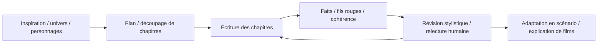

# awesome_novel_writing

**Collection d'applications d'écriture de romans par IA, d'agents de création long format, de Skills d'écriture, d'outils de révision stylistique et de workflows d'adaptation de scénarios.**

Sélection de projets d'écriture de romans par IA, de fiction long format agentique, de Skills d'écriture, d'outils de révision et de workflows de scénarisation — avec des descriptions liées à des preuves et des classements de maintenance GitHub reproductibles.

De l'inspiration, de la bible et du plan jusqu'aux chapitres, aux contrôles de cohérence, à la révision et à l'adaptation, cherchez l'outil selon l'étape réelle de création. Le catalogue privilégie les projets dont l'implémentation est consultable sur GitHub, en signalant explicitement les licences à vérifier et les conditions de licence supplémentaires.

[Index par catégorie](#index-par-catégorie) · [Détail des projets](docs/projects.md) · [Vues de classement](docs/rankings.md) · [Méthode](docs/methodology.md) · [Journal de recherche](docs/research.md) · [Contribuer](CONTRIBUTING.md)

Le diagramme est un chemin de choix ; les projets ne couvrent pas tous les mêmes périmètres. La première version est un point de départ sélectif et ne prétend pas recenser tous les projets ; les étoiles et l'activité de développement ne disent rien de la qualité des œuvres.
