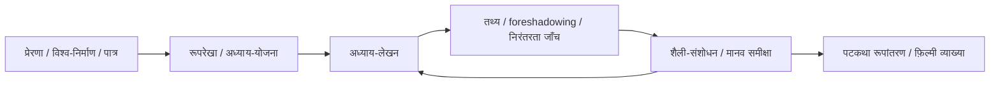

🌐 [English](../../README.md) · [简体中文](../zh/README.md) · [Español](../es/README.md) · **हिन्दी** · [Français](../fr/README.md)

# awesome_novel_writing

**AI उपन्यास-लेखन, दीर्घ-कृति रचनात्मक Agent, लेखन स्किल, शैली-संशोधन और पटकथा रूपांतरण प्रोजेक्ट का क्यूरेटेड संग्रह।**

क्यूरेटेड AI उपन्यास-लेखन ऐप, दीर्घ-कल्पना Agent, लेखन Skill, संशोधन उपकरण और पटकथा वर्कफ़्लो — प्रमाण-लिंक वाले विवरण और दोबारा चलाए जा सकने वाले GitHub मेंटेनेंस रैंकिंग के साथ।

प्रेरणा, सेटिंग और रूपरेखा से लेकर अध्याय, निरंतरता जाँच, संशोधन और रूपांतरण तक — असली लेखन-चरणों के अनुसार टूल खोजें। संग्रह का केंद्र GitHub पर दिखने-योग्य इंप्लीमेंटेशन वाले प्रोजेक्ट हैं, और "लाइसेंस असत्यापित" तथा अतिरिक्त लाइसेंस-शर्तें स्पष्ट रूप से चिह्नित की गई हैं।

[श्रेणी सूची](#श्रेणी-सूची) · [प्रोजेक्ट विवरण तालिका](docs/projects.md) · [रैंकिंग दृश्य](docs/rankings.md) · [विधि](docs/methodology.md) · [खोज रिकॉर्ड](docs/research.md) · [योगदान](CONTRIBUTING.md)



यह आरेख चयन-मार्ग दिखाता है; हर प्रोजेक्ट का दायरा अलग है। प्रारंभिक संस्करण एक चुना हुआ शुरुआती बिंदु है, यह दावा नहीं करता कि सारे प्रोजेक्ट शामिल हैं; star और development गतिविधि रचना की गुणवत्ता के बराबर नहीं हैं।

## श्रेणी पर जाएँ

[उपन्यास-लेखन सॉफ़्टवेयर और वर्कबेंच](#उपन्यास-लेखन-सॉफ़्टवेयर-और-वर्कबेंच) · [स्वचालित लेखन Agent और रचना इंजन](#स्वचालित-लेखन-agent-और-रचना-इंजन) · [दीर्घ-कृति लेखन स्किल और मेथडोलॉजी फ़्रेमवर्क](#दीर्घ-कृति-लेखन-स्किल-और-मेथडोलॉजी-फ़्रेमवर्क) · [शैली-संशोधन, डी-टेम्प्लेटाइज़ेशन और गुणवत्ता जाँच](#शैली-संशोधन-डी-टेम्प्लेटाइज़ेशन-और-गुणवत्ता-जाँच) · [पटकथा, शॉर्ट ड्रामा रूपांतरण और फ़िल्मी व्याख्या](#पटकथा-शॉर्ट-ड्रामा-रूपांतरण-और-फ़िल्मी-व्याख्या) · [रचनात्मक लेखन मूल्यांकन उपकरण](#रचनात्मक-लेखन-मूल्यांकन-उपकरण)

## वर्तमान संग्रह

**कुल 44 प्रोजेक्ट, 14 डी-डुप्लिकेट संदर्भ प्रोजेक्ट की पूर्ण कवरेज के साथ।** फ़ंक्शन सत्यापन: 2026-11-26; मीट्रिक स्नैपशॉट: `2026-11-26T06:43:37+00:00` (UTC)।

हर श्रेणी में पहले मेंटेनेंस स्थिति के अनुसार लेयर बनती है, फिर star (40%), 90-दिन की कमिट गतिविधि (35%) और नवीनतम डिफ़ॉल्ट-ब्रांच कमिट (25%) से समग्र क्रम तय होता है। संग्रहित प्रोजेक्ट पीछे रखे जाते हैं। **मेंटेनेंस स्कोर उपन्यास की गुणवत्ता, साहित्यिक स्तर या वन-क्लिक-बुक पूर्णता की दर नहीं दर्शाता।**

## श्रेणी सूची

`★` उपयोगकर्ता द्वारा दिए गए संदर्भ प्रोजेक्ट दर्शाता है। हर प्रविष्टि की केवल एक मुख्य श्रेणी होती है; सॉफ़्टवेयर, Skill, मेथडोलॉजी फ़्रेमवर्क और मूल्यांकन उपकरण अलग-अलग तुलना में रखे जाते हैं। फ़ंक्शन विवरण सार्वजनिक दस्तावेज़ से लिए गए हैं; थर्ड-पार्टी प्रोजेक्ट इंस्टॉल करके चलाए नहीं गए।

| श्रेणी | संख्या | क्रम में अग्रणी प्रोजेक्ट |
| --- | --- | --- |
| उपन्यास-लेखन सॉफ़्टवेयर और वर्कबेंच | 17 | Biz Novel Studio, Pagekin, StoryForge |
| स्वचालित लेखन Agent और रचना इंजन | 6 | Openwrite, InkOS, novel-harness / Storyteller |
| दीर्घ-कृति लेखन स्किल और मेथडोलॉजी फ़्रेमवर्क | 7 | Oh Story, chinese-novelist, webnovel-writer-opencode |
| शैली-संशोधन, डी-टेम्प्लेटाइज़ेशन और गुणवत्ता जाँच | 8 | avoid-ai-writing, Humanizer, Sepia |
| पटकथा, शॉर्ट ड्रामा रूपांतरण और फ़िल्मी व्याख्या | 5 | drama-skills, shuohao-skills, juben / ai-juben |
| रचनात्मक लेखन मूल्यांकन उपकरण | 1 | Longform Writing Bench |

### उपन्यास-लेखन सॉफ़्टवेयर और वर्कबेंच

| प्रोजेक्ट | उपयोग | रूप | Stars | 90-दिन कमिट | नवीनतम कमिट UTC | मेंटेनेंस स्कोर | लाइसेंस |
| --- | --- | --- | --- | --- | --- | --- | --- |
| [Biz Novel Studio](https://github.com/ExplosiveCoderflome/AI-Novel-Writing-Assistant) ★ · लाइसेंस नोटिस | विश्व, पात्र, अध्याय-वार लेखन और जाँच के इर्द-गिर्द पूरी उपन्यास-उत्पादन प्रक्रिया संगठित करता है। | डेस्कटॉप / सेल्फ़-होस्टेड वर्कबेंच | 3,560 | 898 | 2026-11-25 | 88.2 | AGPL-3.0 + वाणिज्यिक अतिरिक्त शर्तें |
| [Pagekin](https://github.com/EthanYoQ/Pagekin) ★ | सेटिंग और अध्याय-ब्लूप्रिंट से लेकर मुख्य-पाठ, समीक्षा और संशोधन तक का दीर्घ-कृति लेखन वर्कबेंच। | डेस्कटॉप ऐप | 2,909 | 5,208 | 2026-11-24 | 87.3 | GPL-3.0 |
| [StoryForge](https://github.com/yuanbw2025/storyforge) | उपन्यास-सृजन, कथा-रूपांतरण और इंटरैक्टिव अनुभव को कवर करने वाला local-first नैरेटिव टूल। | लेखन वर्कबेंच | 1,051 | 3,251 | 2026-11-25 | 84.0 | MIT |
| [NeuroBook](https://github.com/notnotype/neuro-book) | एडिटर, प्रोजेक्ट फ़ाइलें और एक्सपेंडिबल टूल से दीर्घ-कृति लेखन संगठित करता है। | लेखन IDE / प्रीव्यू | 800 | 8,471 | 2026-11-26 | 83.2 | AGPL-3.0 |
| [Denova](https://github.com/alfredxw/denova) ★ | उपन्यास, इंटरैक्टिव कथा, संदर्भ-संग्रह और Agent टूल एक ही वर्कस्पेस में रखता है। | लेखन प्लेटफ़ॉर्म | 1,054 | 357 | 2026-11-24 | 81.8 | Apache-2.0 |
| [Reveric](https://github.com/looplj/reveric) ★ · लाइसेंस नोटिस | Agent से दीर्घ-उपन्यास, पटकथा-रूपांतरण, स्टोरीबोर्ड, 3D डायरेक्टर डेस्क और एडिटिंग प्रवाह को जोड़ने वाला डेस्कटॉप लेखन वर्कबेंच। | local-first डेस्कटॉप लेखन वर्कबेंच | 1,007 | 270 | 2026-11-25 | 80.4 | AGPL-3.0 + धारा 7 एट्रिब्यूशन आवश्यकता |
| [Goink](https://github.com/sigpanic/goink) | Agent लेखन-निर्णय, संरचित मेमोरी और लेखन-पश्चात् स्थिति-जाँच को जोड़ने वाला लेखन सिस्टम। | डेस्कटॉप ऐप | 550 | 416 | 2026-11-19 | 79.1 | AGPL-3.0 |
| [OpenFic](https://github.com/syrizelink/OpenFic) | सेटिंग, पात्र और कस्टमाइज़ करने योग्य Prompt / Agent वर्कफ़्लो से दीर्घ-कृति सह-सृजन का साथ देता है। | क्रॉस-प्लेटफ़ॉर्म ऐप | 1,321 | 109 | 2026-11-26 | 76.4 | Apache-2.0 |
| [easy-writing](https://github.com/yilujian/easy-writing) ★ | लोकल अध्याय-संपादन, वर्ड-गिनती स्टैटिस्टिक्स, AI-सहायित लेखन और रचना-प्रबंधन। | डेस्कटॉप ऐप | 981 | 33 | 2026-11-03 | 63.2 | AGPL-3.0 |
| [Novel Studio](https://github.com/bbaz123/novel-studio) | एडिटर के साथ कथा-सेटिंग, पात्र-स्थिति, foreshadowing प्रबंधन और निरंतरता जाँच। | लोकल Web वर्कबेंच | 9 | 194 | 2026-11-23 | 61.8 | MIT |
| [AI Novel Generator](https://github.com/YILING0013/AI_NovelGenerator) | पात्र, संबंध, कथा-योजना और मुख्य-पाठ प्रोजेक्ट में रखता है; उम्मीदवार जनरेट होने पर मानव समीक्षा से सहेजा जाता है। | लोकल वर्कबेंच | 6,546 | 5 | 2026-11-05 | 60.4 | AGPL-3.0 |
| [Vela](https://github.com/heider-x/vela) | रूपरेखा, ड्राफ्टिंग, पुनर्लेखन और समीक्षा को लोकल RAG नॉलेजबेस से जोड़ता है। | डेस्कटॉप IDE | 593 | 21 | 2026-10-19 | 56.0 | GPL-3.0 |
| [NovelClaw](https://github.com/iLearn-Lab/NovelClaw) | अध्याय-मसौदे, जाँच-योग्य रन, समीक्षा और संपादन-योग्य मेमोरी से दीर्घकालिक सृजन संगठित करता है। | सेल्फ़-होस्टेड वर्कबेंच | 375 | 3 | 2026-10-12 | 43.6 | MIT |
| [51mazi](https://github.com/xiaoshengxianjun/51mazi) | उपन्यास-संपादन और लेखन-सहायता टूल; AI लेखन और रचना-सामग्री क्षमताएँ शामिल। | डेस्कटॉप ऐप | 510 | 1 | 2026-08-31 | 35.1 | MIT |
| [ai-novelist](https://github.com/FlickeringLamp/ai-novelist) | टूल-कॉलिंग और human-in-the-loop के साथ AI टेक्स्ट सह-सृजन का अन्वेषण। | डेस्कटॉप लेखन उपकरण | 227 | 0 | 2026-07-25 | 25.2 | MIT |
| [xnovelist](https://github.com/giapnguyen74/xnovelist) | ब्राउज़र में पाठ लोकल रूप से संगठित करता है; स्वयं चुना गया मॉडल AI लेखन-सहायता देता है। | ब्राउज़र-लोकल ऐप | 13 | 0 | 2026-06-08 | 12.9 | MIT |
| [Agnes Creative OS](https://github.com/MXD706/agnes) · लाइसेंस नोटिस | विश्व-सेटिंग, पात्र, कथानक, अध्याय, समीक्षा और दीर्घकालिक मेमोरी को कवर करने वाला उपन्यास वर्कबेंच। | लोकल वर्कबेंच | 3 | 0 | 2026-05-27 | 8.1 | असत्यापित |

### स्वचालित लेखन Agent और रचना इंजन

| प्रोजेक्ट | उपयोग | रूप | Stars | 90-दिन कमिट | नवीनतम कमिट UTC | मेंटेनेंस स्कोर | लाइसेंस |
| --- | --- | --- | --- | --- | --- | --- | --- |
| [Openwrite](https://github.com/LiPu-jpg/Openwrite) | AI वर्कफ़्लो से उपन्यास-सृजन, शैली-प्रसंस्करण और सामग्री-समीक्षा संगठित करता है। | लेखन इंजन | 1,023 | 218 | 2026-11-20 | 77.9 | Apache-2.0 |
| [InkOS](https://github.com/Narcooo/inkos) ★ | कथा-योजना, लेखन, समीक्षा और संशोधन का समर्थन करने वाला रचनात्मक Agent सिस्टम। | लेखन Agent / वर्कबेंच | 11,440 | 46 | 2026-10-24 | 71.5 | AGPL-3.0 |
| [novel-harness / Storyteller](https://github.com/Dankular/Storyteller) · लाइसेंस नोटिस | कथा-सेटिंग, प्लॉट-पॉइंट, foreshadowing ledger और निरंतरता-रिकॉर्ड से दीर्घ-कृति के अध्याय-वार लेखन का साथ देता है। | राइटिंग Harness | 0 | 7 | 2026-09-12 | 22.6 | असत्यापित |
| [Novelist Agent](https://github.com/AxolDad/novelist) · लाइसेंस नोटिस | डेटाबेस-मेमोरी और multi-lane समीक्षा तंत्र से दीर्घकृतिकोत्तर पात्र, कथानक और स्वर को बनाए रखता है। | Agent सिस्टम / Alpha | 2 | 0 | 2026-01-06 | 4.5 | असत्यापित |
| [Long-Novel-GPT](https://github.com/MaoXiaoYuZ/Long-Novel-GPT) · लाइसेंस नोटिस | रूपरेखा, अध्याय और मुख्य-पाठ की स्तरीय विस्तार-रचना से दीर्घ-उपन्यास जनरेशन संगठित करता है। | दीर्घ-उपन्यास जनरेटर / Agent | 1,260 | 0 | 2025-11-05 | 25.1 | असत्यापित |
| [Kimi Writing Agent](https://github.com/Doriandarko/kimi-writer) · लाइसेंस नोटिस | मॉडल से योजना, लेखन और फ़ाइल-प्रबंधन करता है; संदर्भ-सारांश से दीर्घ-कृति लेखन फिर उठाता है। | CLI / Agent | 596 | 0 | 2025-11-08 | 22.6 | MIT + वाणिज्यिक एट्रिब्यूशन शर्त |

### दीर्घ-कृति लेखन स्किल और मेथडोलॉजी फ़्रेमवर्क

| प्रोजेक्ट | उपयोग | रूप | Stars | 90-दिन कमिट | नवीनतम कमिट UTC | मेंटेनेंस स्कोर | लाइसेंस |
| --- | --- | --- | --- | --- | --- | --- | --- |
| [Oh Story](https://github.com/zenstory-ai/oh-story-claudecode) | web-novel शोध, विघटन-विश्लेषण, दीर्घ/लघु-कृति लेखन और संशोधन को कवर करने वाला स्किल वर्कफ़्लो। | Agent स्किल पैक | 8,945 | 160 | 2026-11-24 | 84.8 | MIT |
| [chinese-novelist](https://github.com/PenglongHuang/chinese-novelist-skill) ★ | सवाल-जवाब, रचनात्मक मेमोरी और अध्याय-बाध्यता से चीनी-भाषी उपन्यास-लेखन की सहायता करता है। | Agent Skill | 5,587 | 57 | 2026-11-25 | 77.7 | MIT |
| [webnovel-writer-opencode](https://github.com/lujih/webnovel-writer-opencode) | दीर्घ web-novel वर्कफ़्लो को OpenCode पर अनुकूलित करता है और लेखन-प्रबंधन क्षमताएँ जोड़ता है। | OpenCode पोर्ट / एक्सटेंशन | 228 | 205 | 2026-11-25 | 73.7 | GPL-3.0 |
| [webnovel-writer](https://github.com/lingfengQAQ/webnovel-writer) | स्तरीय योजना, कथा-स्थिति और रिट्रीवल से दीर्घ web-novel serialization का साथ देता है। | Agent प्लगइन् / स्किल | 8,080 | 18 | 2026-11-19 | 71.0 | GPL-3.0 |
| [FuFu](https://github.com/usagifufu/FuFu-Novel-Writing) · लाइसेंस नोटिस | शोध, विश्व-सेटिंग, रूपरेखा, foreshadowing, अध्याय और परीक्षण से दीर्घ-कृति लेखन-प्रवाह संगठित करता है। | WorkBuddy स्किल पैक | 4 | 12 | 2026-10-19 | 36.4 | असत्यापित |
| [novel-writing-framework](https://github.com/LAY-lgtm/novel-writing-framework) ★ | रूपरेखा, अध्याय-वार लेखन, स्व-जाँच और प्लेटफ़ॉर्म-अनुकूलन को इंजीनियर्ड लेखन-मेथड में संगठित करता है। | मेथडोलॉजी / Agent स्किल | 277 | 0 | 2026-05-31 | 23.0 | MIT |
| [long-novel-writer](https://github.com/jiaw-Zh/long-novel-writer) · लाइसेंस नोटिस | स्तरीय सारांश और कथा-तथ्य प्रबंधन के इर्द-गिर्द दीर्घकालिक serialization संगठित करता है। | दीर्घ-उपन्यास लेखन Skill | 97 | 0 | 2026-05-15 | 18.8 | असत्यापित |

### शैली-संशोधन, डी-टेम्प्लेटाइज़ेशन और गुणवत्ता जाँच

| प्रोजेक्ट | उपयोग | रूप | Stars | 90-दिन कमिट | नवीनतम कमिट UTC | मेंटेनेंस स्कोर | लाइसेंस |
| --- | --- | --- | --- | --- | --- | --- | --- |
| [avoid-ai-writing](https://github.com/conorbronsdon/avoid-ai-writing) ★ | template-जैसी AI शैली का निदान और पुनर्लेखन; केवल-डिटेक्शन और इन-प्लेस एडिटिंग जैसे मोड देता है। | Agent Skill / जाँच उपकरण | 6,322 | 518 | 2026-11-24 | 90.0 | MIT |
| [Humanizer](https://github.com/blader/humanizer) | आम AI-लेखन-लक्षणों के आधार पर पाठ जाँचकर पुनर्लेखन करता है। | अंग्रेज़ी पॉलिश Skill | 73,688 | 70 | 2026-11-19 | 86.2 | MIT |
| [Sepia](https://github.com/Nanako0129/sepia) ★ | पहले उपन्यास की कथा-संरचना ठीक करता है, फिर शब्द-वाक्य संभालता है; अन्य शैलियाँ स्थिति के अनुसार नियम। | Agent Skill | 3,957 | 380 | 2026-11-03 | 81.6 | MIT |
| [SimpleEnglish](https://github.com/AminBlg/SimpleEnglish) | Agent skill जो LLM से ASD-STE100 नियंत्रित अंग्रेज़ी में दस्तावेज़ और उत्तर लिखाती है: छोटे वाक्य, सकर्मी विधि, एक शब्द-एक अर्थ; डिफ़ॉल्ट सरल, मांग पर सख़्त। | नियंत्रित-अंग्रेज़ी लेखन Skill | 4,670 | 56 | 2026-11-10 | 73.2 | MIT |
| [STE80 Humanizer](https://github.com/Dodaios/ste80-humanizer) | दो-पास पुनर्लेखन: पहले Wikipedia की Signs of AI writing सूची के 26 AI लक्षण हटाता है, फिर वाक्यों को ASD-STE100 नियंत्रित अंग्रेज़ी की ओर दोबारा बनाता है। | अंग्रेज़ी पुनर्लेखन Skill | 1,138 | 14 | 2026-11-24 | 64.3 | MIT |
| [Humanizer-zh](https://github.com/op7418/Humanizer-zh) | चीनी-भाषी नियमों से यांत्रिक और सारहीन AI अभिव्यक्ति-पैटर्न की पहचान व सुधार करता है। | चीनी पॉलिश Skill | 23,820 | 1 | 2026-09-23 | 51.2 | MIT |
| [qifeng-writing](https://github.com/Yuriloll/qifeng-writing) ★ | चीनी-भाषी सोशल पोस्ट और लेखों में तथ्य, संरचना, कथा और भाषा की समस्याओं का निदान करता है। | चीनी लेखन Skill | 40 | 2 | 2026-08-31 | 28.6 | MIT |
| [llmlint](https://github.com/notnotype/llmlint) | नियमों से लेखन-चिह्नों को स्कैन करके संशोधन के लिए स्थान-निर्दिष्ट समस्याएँ देता है। | टेक्स्ट रूल चेकर | 13 | 0 | 2026-08-15 | 17.1 | AGPL-3.0 |

### पटकथा, शॉर्ट ड्रामा रूपांतरण और फ़िल्मी व्याख्या

| प्रोजेक्ट | उपयोग | रूप | Stars | 90-दिन कमिट | नवीनतम कमिट UTC | मेंटेनेंस स्कोर | लाइसेंस |
| --- | --- | --- | --- | --- | --- | --- | --- |
| [drama-skills](https://github.com/zenstory-ai/drama-skills) | शॉर्ट ड्रामा कथा-डेवलपमेंट, पटकथा, संपत्ति-प्रबंधन और स्टोरीबोर्ड के इर्द-गिर्द सृजन-प्रवाह संगठित करता है। | शॉर्ट ड्रामा स्किल पैक | 5,043 | 187 | 2026-11-24 | 83.7 | MIT |
| [shuohao-skills](https://github.com/eternityspring/shuohao-skills) ★ | उपन्यास-रूपांतरण रूपरेखा, पात्र और पटकथा से सीन-स्टेजिंग और स्टोरीबोर्ड डिलीवरी तक पहुँचता है। | शॉर्ट ड्रामा निर्माण स्किल पैक | 7,154 | 54 | 2026-11-09 | 74.2 | Apache-2.0 |
| [juben / ai-juben](https://github.com/VanGong1999/juben) ★ | पेशेवर Agent वर्कफ़्लो से फ़िल्म-प्लानिंग, पटकथा-लेखन और मूल्यांकन की सहायता करता है। | पटकथा Agent प्लेटफ़ॉर्म | 193 | 7 | 2026-11-22 | 53.9 | MIT |
| [Narrator AI CLI Skill](https://github.com/NarratorAI-Studio/narrator-ai-cli-skill) ★ | Agent को फ़िल्मी व्याख्या-निर्माण के लिए CLI कॉल करना निर्देशित करता है। | CLI-सहायक Skill | 3,325 | 0 | 2026-07-05 | 33.2 | MIT |
| [ai-short-drama](https://github.com/Hao0321/ai-short-drama) | AI शॉर्ट ड्रामा के लिए कथा-डिज़ाइन और पटकथा-लेखन का Skill। | पटकथा-लेखन Skill | 84 | 0 | 2026-08-13 | 23.2 | MIT |

### रचनात्मक लेखन मूल्यांकन उपकरण

| प्रोजेक्ट | उपयोग | रूप | Stars | 90-दिन कमिट | नवीनतम कमिट UTC | मेंटेनेंस स्कोर | लाइसेंस |
| --- | --- | --- | --- | --- | --- | --- | --- |
| [Longform Writing Bench](https://github.com/EQ-bench/longform-writing-bench) · लाइसेंस नोटिस | मॉडलों की रचनात्मक योजना, संशोधन और लघु/मध्य-कथा जनरेशन का मूल्यांकन करता है। | शोध / मूल्यांकन उपकरण | 49 | 0 | 2025-10-26 | 13.9 | असत्यापित |

## कैसे चुनें

- पहले सॉफ़्टवेयर खोलकर लिखना चाहते हैं: उपन्यास वर्कबेंच देखें; संपादन और समीक्षा अनुभव, मॉडल कॉन्फ़िगरेशन और बैकअप तरीक़े की तुलना करें।
- अध्याय-वार लेखन को दोहराए जाने योग्य प्रवाह बनाना चाहते हैं: रचनात्मक Agent और दीर्घ-कृति स्किल देखें; स्थिति, foreshadowing और संशोधन तंत्र पहले जाँचें।
- मुख्य-पाठ पहले से है और संशोधन चाहिए: Sepia, avoid-ai-writing जैसे संशोधन उपकरण देखें; सामान्य-लेख के नियम ज़रूरी नहीं कि उपन्यास पर लागू हों।
- उपन्यास को शॉर्ट ड्रामा बनाना चाहते हैं: पटकथा और रूपांतरण श्रेणी देखें; फ़िल्मी व्याख्या मूल पटकथा नहीं है।

और विस्तृत सीमाएँ और स्रोत [प्रोजेक्ट विवरण तालिका](docs/projects.md) में, लेखन-चरण और श्रेणीकरण [श्रेणी मानक](docs/taxonomy.md) में दिए हैं।

## रैंकिंग, डेटा और मेंटेनेंस

- [समग्र / Star / गतिविधि / नवीनतम कमिट के अनुसार रैंकिंग](docs/rankings.md)
- [रैंकिंग सूत्र और सीमाएँ](docs/methodology.md)
- [खोज प्रक्रिया, प्रोजेक्ट पुनर्नाम और सीड मैपिंग](docs/research.md)
- [डेटा JSON](../../data/projects.json) · [मीट्रिक JSON](../../data/metrics.json) · [रैंकिंग CSV](../../data/rankings.csv)
- [योगदान मार्गदर्िका](CONTRIBUTING.md)

```sh
python scripts/refresh_metrics.py   # gh लॉगिन या GH_TOKEN चाहिए
python scripts/build.py
python -m unittest discover -s tests -v
python scripts/build.py --check
```

GitHub Actions रोज़ाना संग्रहीत रिपॉज़िटरी के मीट्रिक और रैंकिंग रीफ़्रेश करता है। नए प्रोजेक्ट, श्रेणी, फ़ंक्शन और लाइसेंस-निर्णय मैन्युअल समीक्षा के बाद अपडेट होते हैं। API क्वेरी अधूरी होने पर पिछला संपूर्ण स्नैपशॉट बरक़रार रहता है।

## लाइसेंस और आभार

इस डायरेक्टरी का मौलिक संकलन और स्क्रिप्ट [MIT](../../LICENSE) के तहत हैं; लिंक किए गए प्रोजेक्ट अपने-अपने लाइसेंस पर चलते हैं। सार्वजनिक सोर्स, README के ओपन-सोर्स दावे और GitHub की पहचाने गई SPDX-लाइसेंस को प्रोजेक्ट की अतिरिक्त शर्तों के साथ पढ़ना चाहिए। असत्यापित लाइसेंस को कभी डिफ़ॉल्ट में MIT नहीं लिखा जाता।

रैंकिंग और अपडेट कार्यान्वयन [awesome_bot](https://github.com/ZanePoe/awesome_bot) का अनुसरण करता है। खोज-संकेत के लिए [Awesome Novel Tools](https://github.com/yutingzhao1991/awesome-novel-tools) और [Awesome Novel Skills](https://github.com/UnderleveledBuilder/awesome-novel-skills) का संदर्भ लिया गया; हर अंतिम विवरण मूल रिपॉज़िटरी पर जाँचा गया।

[परिवर्तन रिकॉर्ड](../../record/) सत्यापन के समय का मूल पाठ (चीनी में) सुरक्षित रखता है, ताकि हर निर्णय के स्रोत और उस समय के शब्द-चयन का ऑडिट हो सके।
