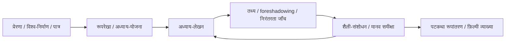

# awesome_novel_writing

**AI उपन्यास-लेखन, दीर्घ-कृति रचनात्मक Agent, लेखन स्किल, शैली-संशोधन और पटकथा रूपांतरण प्रोजेक्ट का क्यूरेटेड संग्रह।**

क्यूरेटेड AI उपन्यास-लेखन ऐप, दीर्घ-कल्पना Agent, लेखन Skill, संशोधन उपकरण और पटकथा वर्कफ़्लो — प्रमाण-लिंक वाले विवरण और दोबारा चलाए जा सकने वाले GitHub मेंटेनेंस रैंकिंग के साथ।

प्रेरणा, सेटिंग और रूपरेखा से लेकर अध्याय, निरंतरता जाँच, संशोधन और रूपांतरण तक — असली लेखन-चरणों के अनुसार टूल खोजें। संग्रह का केंद्र GitHub पर दिखने-योग्य इंप्लीमेंटेशन वाले प्रोजेक्ट हैं, और "लाइसेंस असत्यापित" तथा अतिरिक्त लाइसेंस-शर्तें स्पष्ट रूप से चिह्नित की गई हैं।

[श्रेणी सूची](#श्रेणी-सूची) · [प्रोजेक्ट विवरण तालिका](docs/projects.md) · [रैंकिंग दृश्य](docs/rankings.md) · [विधि](docs/methodology.md) · [खोज रिकॉर्ड](docs/research.md) · [योगदान](CONTRIBUTING.md)

यह आरेख चयन-मार्ग दिखाता है; हर प्रोजेक्ट का दायरा अलग है। प्रारंभिक संस्करण एक चुना हुआ शुरुआती बिंदु है, यह दावा नहीं करता कि सारे प्रोजेक्ट शामिल हैं; star और development गतिविधि रचना की गुणवत्ता के बराबर नहीं हैं।
